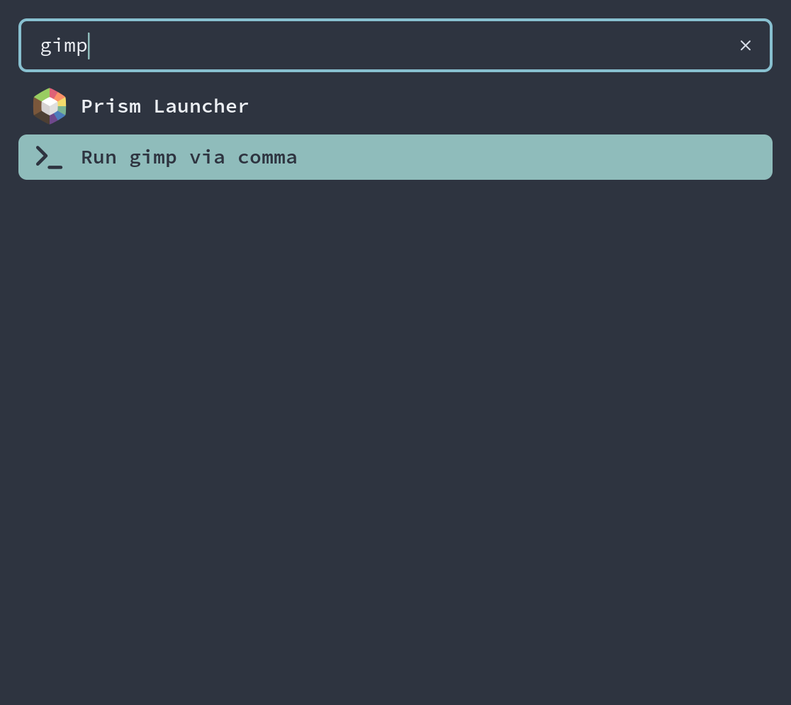
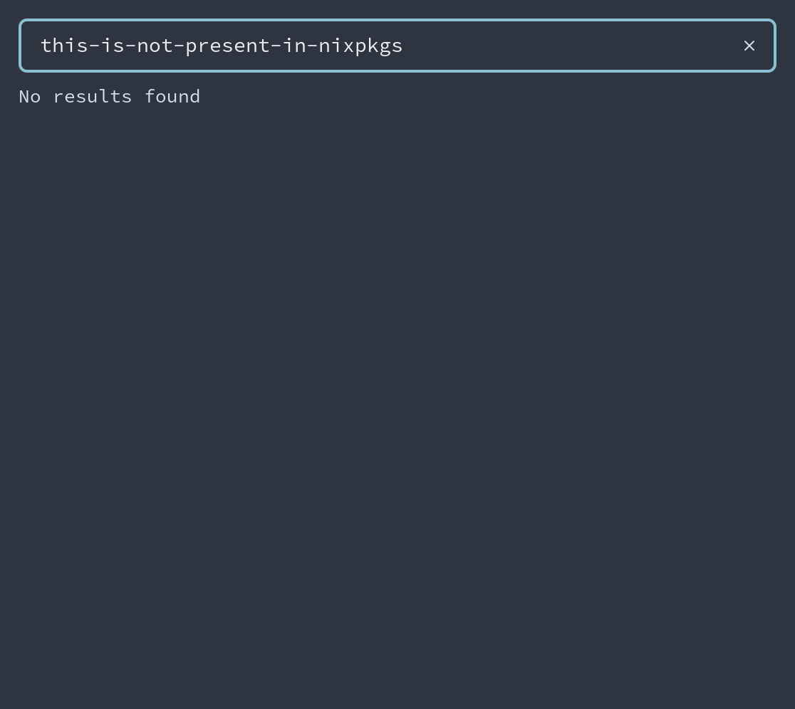
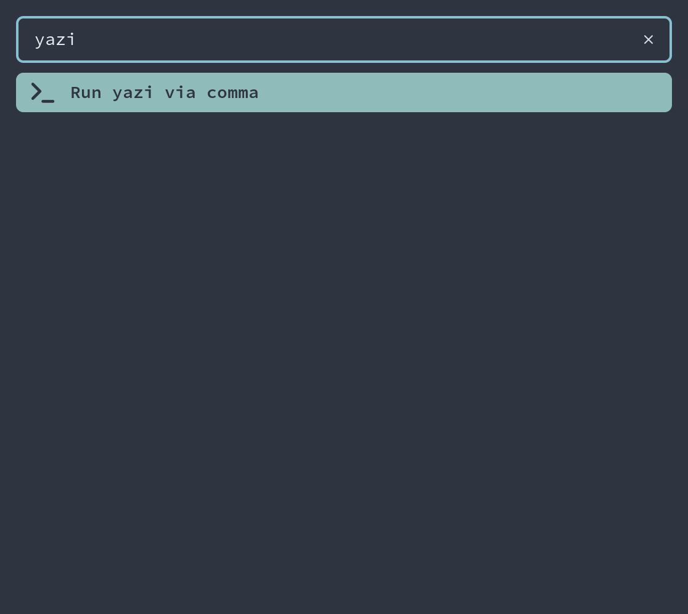
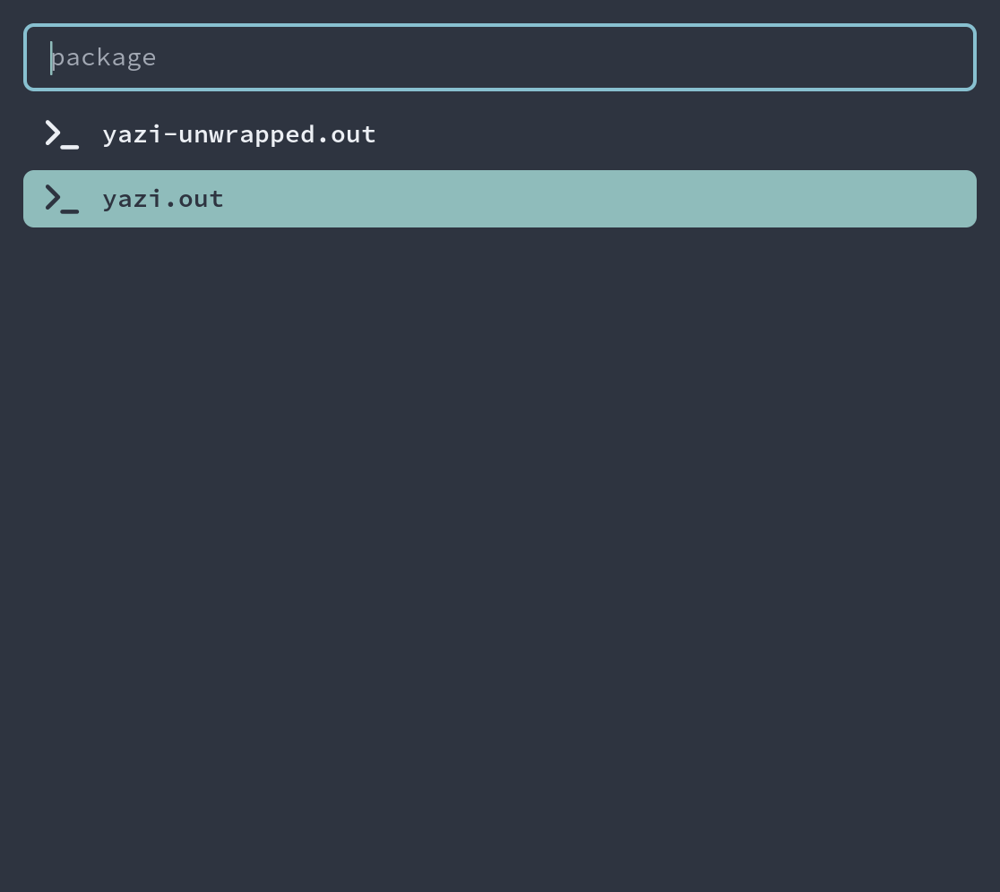
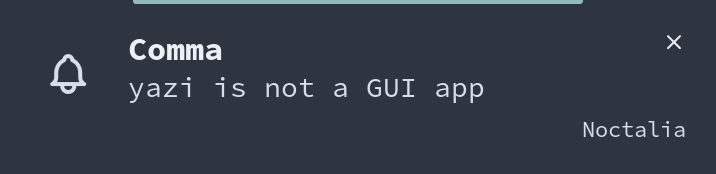

# Comma

Comma launches GUI apps from nixpkgs straight from the Noctalia launcher using
[comma](https://github.com/nix-community/comma), without installing them first.

## Plugin

| Field | Value |
| --- | --- |
| ID | `toniogela/comma` |
| Entries | Launcher provider: `run` |
| Launcher Prefix | `/,` |

## Requirements

Install `,` (comma, with a nix-index database such as the one from
[nix-index-database](https://github.com/nix-community/nix-index-database)) and
`grep` on `PATH`. Nix must be able to fetch from nixpkgs.

## Usage

Type the name of an executable in the Noctalia launcher. The launcher provider
`run` takes part in global search, so no prefix is needed; you can also type
`/,` to search only this provider. For example:

```text
gimp
```

When a nixpkgs package provides that executable, the launcher shows
`Run gimp via comma` alongside your installed apps. Anything after the
executable name is passed to the app as arguments, split on whitespace.



Names that no nixpkgs package provides get no entry.



Activating the result fetches the package and starts the app. When several
packages provide the executable (for example `yazi.out` and
`yazi-unwrapped.out`), a second launcher prompt titled `package` asks which
one to run.





Only GUI apps are launched: the package must ship a `.desktop` file that is not
marked `Terminal=true`. For anything else, such as `yazi` or `htop`, a
notification says it is not a GUI app.



## Notes

- Spawned processes: every query runs `, -p <name>` to check the nix-index
  database. Activating a result runs `, -x <name>` to fetch the package, checks
  its `share/applications/*.desktop` files with `grep`, then starts the
  executable detached. Errors are reported with
  `noctalia msg notification-show`.
- Package picker: comma's own picker needs a terminal, so the plugin writes a
  one-line script, `$XDG_RUNTIME_DIR/noctalia-comma-pick`, that runs
  `noctalia dmenu -p package`, and passes it to comma with `-P`. It is rewritten
  on every launch. If `XDG_RUNTIME_DIR` is not set, nothing is launched.
- Network: the plugin makes no network calls itself. Nix downloads the package
  from the binary cache, which can take a while for large apps; there is no
  progress indicator.
- Packages are downloaded before the GUI check, so picking a command-line tool
  still fetches it into the Nix store.
- Arguments are split on whitespace with no quoting.
